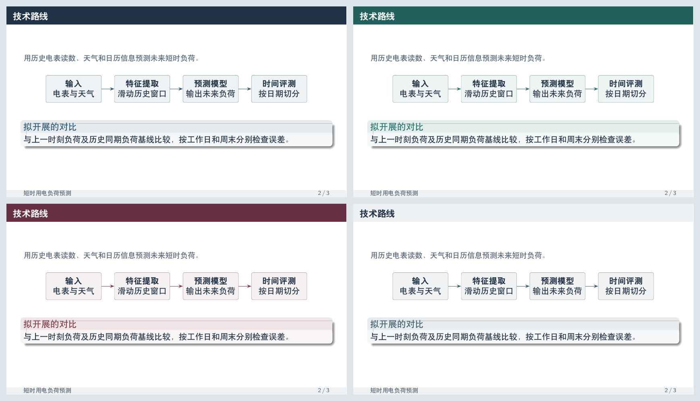

# 硕士开题答辩 Beamer

给 Codex 上传一份开题报告，生成可编辑的中文 Beamer 答辩稿和科研配图。默认采用 **13 页、16:9、Madrid 主题**，按报告内容选择约 **5 张科研图**，并用 XeLaTeX 检查页数和排版。页数、图数和主题都可以在调用时指定。

上排为深蓝·学院与青绿·清透，下排为酒红·典礼与浅灰·极简。预览来自 XeLaTeX 实际编译的虚构课题，流程图用 TikZ 绘制。

## 在 Codex 中安装

**用 Codex 安装**。在 Codex 中发送这条指令：

    用 $skill-installer 安装 https://github.com/ssxszc/thesis-proposal-beamer/tree/main 的根目录技能。路径用 .，安装名用 thesis-proposal-beamer。

**手动安装**。在 macOS 或 Linux 终端运行：

~~~bash
mkdir -p "$HOME/.agents/skills"
git clone https://github.com/ssxszc/thesis-proposal-beamer.git "$HOME/.agents/skills/thesis-proposal-beamer"
~~~

也可把技能放在工程下的 `.agents/skills/thesis-proposal-beamer/`，仅在该工程中使用。安装后如果技能未出现，重启 Codex。[Codex Skills 官方文档](https://developers.openai.com/codex/skills/)

## 上传报告并调用

在 Codex 桌面端添加报告附件，或者将报告放到 Codex CLI 能读取的工程内并在提示中写明文件路径。然后发送：

    用 $thesis-proposal-beamer 根据附件生成我的开题答辩。

可以同时指定主题和配图数量：

    用 $thesis-proposal-beamer 处理开题报告.docx，采用 Boadilla + Dolphin，做 13 页并配 4 张科研图。

| 风格 | 配色与版式 | `DefenseStyle` |
| --- | --- | --- |
| 深蓝·学院（默认） | 深蓝底、白字 | 1 |
| 青绿·清透 | 青绿底、白字 | 2 |
| 酒红·典礼 | 酒红底、白字 | 3 |
| 浅灰·极简 | 浅灰底、深字 | 4 |
| Madrid + Dolphin | Dolphin 原生配色，Madrid 页脚 | 5 |
| Boadilla + Dolphin | Dolphin 原生配色，Boadilla 页脚 | 6 |

左侧为 Madrid + Dolphin，右侧为 Boadilla + Dolphin。

生成后可在主文档开头修改 `DefenseStyle`，再编译查看。旧版 Word `.doc` 需要可用的文本转换工具，扫描件需要 OCR。

## 生图方式

**默认使用 Codex 内置生图，首选 Images 2.6。** 当前工具支持选择时使用 Images 2.6。工具只提供通用生图入口时，使用该入口。只有工具确认模型时，提示词文件才标记为 Images 2.6。

**也可以使用自配 API。** 支持 OpenAI 兼容的图片生成接口。把密钥设为 Codex 或其他 Harness 进程可读取的环境变量，再在会话中写明 API 地址、供应商模型 ID 和环境变量名：

    用 $thesis-proposal-beamer 根据附件生成开题答辩。
    使用我的 OpenAI 兼容生图 API https://images.example.com/v1，
    模型 provider-image-model，密钥环境变量名 PROPOSAL_IMAGE_API_KEY。

把示例地址和模型 ID 换成供应商提供的值。API 只接收去标识的单图提示词。默认使用内置工具时无需配置 API。所选服务不可用或图中逻辑无法准确表达时，技能改用 TikZ 等绘图工具，逐图注明实际生成方式。[接口参数与回退说明](references/image-backends.md)

## 在其他 Harness 中使用

将整个仓库作为一个技能目录，放入支持 Agent Skills 的客户端所配置的技能路径。目录名用 `thesis-proposal-beamer`，并保留根目录的 `SKILL.md` 与其相对资源。再按该客户端的方式启用技能，附上报告或提供文件路径。

客户端需要能读取报告和写入工作区。内置生图可用时，技能会根据每张图的独立提示词生成并核对配图。工具不可用或图中关系难以准确生成时，用 TikZ 等绘图工具生成图片。编译验收可使用本地含 CTeX、Fandol 和 Beamer 的 XeLaTeX 环境，也可使用兼容的 Docker 镜像。完整的运行要求见 [编译说明](references/defense.md)。[Agent Skills 规范](https://agentskills.io/specification)

## 默认成品

~~~text
开题报告/
├── 开题报告.tex
└── figures/
    ├── Frame 02-研究背景及意义.png
    ├── Frame 02-研究背景及意义.md
    ├── Frame 06-整体技术路线.pdf
    └── Frame 06-整体技术路线.md
~~~

`figures/` 中的 PDF 是单张矢量科研图。每张图旁的同名 Markdown 含 13 项提示词规格、实际提交的提示词或绘图设计、生成方式，以及可确认的模型。整套答辩的验收 PDF、编译日志和公共图稿规范保留在工作目录。把 `.tex` 和 `figures/` 中的图片按原目录结构导入 Ayakaleaf 或 Overleaf，选择 **XeLaTeX**。使用本地 TeX Live 时，在成品目录运行：

~~~bash
latexmk -xelatex 开题报告.tex
~~~
