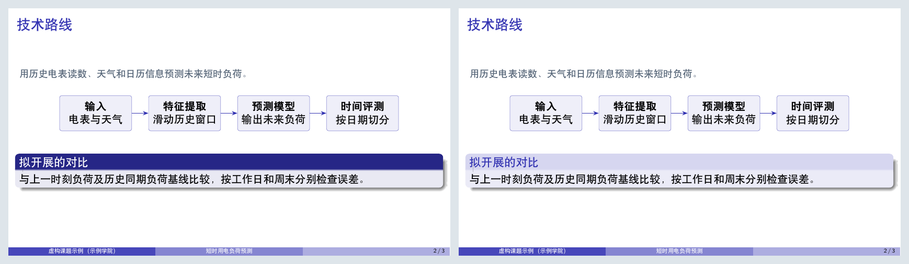
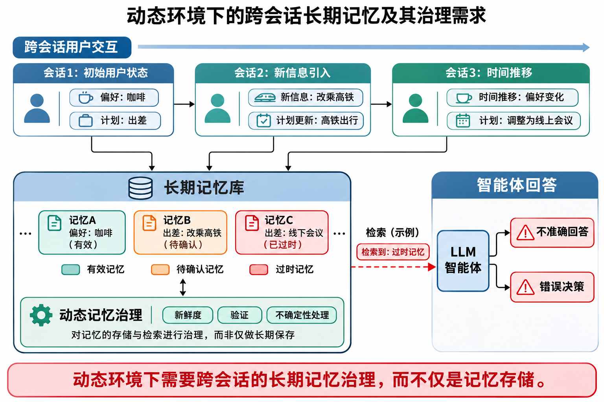

# docx2Latex

将学术报告、开题报告、文献综述和科研项目汇报等 Word 文档转换为可编辑的 **LaTeX Beamer 幻灯片**。逐页大纲来自上传文档的章节、论点和证据。可以自定义主题、总页数和配图数量。未指定时使用原文主要语言、16:9、深蓝·学院主题、**13 页和约 5 张配图**。

上排为深蓝·学院与青绿·清透，下排为酒红·典礼与浅灰·极简。预览来自 XeLaTeX 实际编译的虚构课题，流程图用 TikZ 绘制。

## 推荐使用 Codex 安装

在 Codex 中发送：

    用 $skill-installer 安装 https://github.com/ssxszc/docx2Latex/tree/main 的根目录技能。路径用 .，安装名用 docx2latex。

也可以在 macOS 或 Linux 终端手动安装：

~~~bash
mkdir -p "$HOME/.agents/skills"
git clone https://github.com/ssxszc/docx2Latex.git "$HOME/.agents/skills/docx2latex"
~~~

仅在特定项目中使用时，把技能放在工程下的 `.agents/skills/docx2latex/`。安装后如果技能未出现，重启 Codex。[Codex Skills 官方文档](https://developers.openai.com/codex/skills/)

已用 Git 克隆旧版技能的用户可将本地技能目录改为 `docx2latex`，再把原有 `origin` 改为 `https://github.com/ssxszc/docx2Latex.git` 并拉取更新。通过安装器安装的旧版可按上面的指令安装新技能。

## 上传报告并调用

在 Codex 桌面端添加报告附件，或者将报告放到 Codex CLI 能读取的工程内并在提示中写明文件路径。然后发送：

    用 $docx2latex 根据附件生成 Beamer 幻灯片。

也可以同时指定主题、总页数和配图数量：

    用 $docx2latex 处理学术报告.docx，采用 Boadilla + Dolphin，总共 10 页，配 3 张科研图。

| 风格 | 配色与版式 | `DefenseStyle` |
| --- | --- | --- |
| 深蓝·学院（默认） | 深蓝底、白字 | 1 |
| 青绿·清透 | 青绿底、白字 | 2 |
| 酒红·典礼 | 酒红底、白字 | 3 |
| 浅灰·极简 | 浅灰底、深字 | 4 |
| Madrid + Dolphin | Dolphin 原生配色，Madrid 页脚 | 5 |
| Boadilla + Dolphin | Dolphin 原生配色，Boadilla 页脚 | 6 |

左侧为 Madrid + Dolphin，右侧为 Boadilla + Dolphin。

总页数包含封面，配图数可设为 0。生成后可在主文档开头修改 `DefenseStyle`，再编译查看。推荐上传 `.docx`。旧版 Word `.doc` 需要可用的文本转换工具，扫描件需要 OCR。

## 科研插图效果

技能根据报告对应章节分别编写提示词，明确分区、节点、箭头方向和图内术语，适用于研究动机图、技术路线图、模型架构图和实验流程图。默认采用白底、扁平科研绘图风格，按幻灯片版面安排画幅。生成后回到原文核对中文标签、箭头和分支，每张图都附有实际使用的提示词。

这张 3:2 示例图用时间轴串起三次用户会话，用颜色区分有效、待确认和过时记忆，再用红色虚线标出检索到过时记忆可能引发的错误回答。[查看原始提示词与成图](references/figure-prompt-example.md)

## 生图方式

**默认使用 Codex 内置生图，首选 Images 2.6。** 当前工具支持选择时使用 Images 2.6。工具只提供通用生图入口时，使用该入口。只有工具确认模型时，提示词文件才标记为 Images 2.6。

**也可以使用自配 API。** 支持 OpenAI 兼容的图片生成接口。把密钥设为 Codex 或其他 Harness 进程可读取的环境变量，再在会话中写明 API 地址、供应商模型 ID 和环境变量名：

    用 $docx2latex 根据附件生成 Beamer 幻灯片。
    使用我的 OpenAI 兼容生图 API https://images.example.com/v1，
    模型 provider-image-model，密钥环境变量名 DOCX2LATEX_IMAGE_API_KEY。

把示例地址和模型 ID 换成供应商提供的值。API 只接收去标识的单图提示词。默认使用内置工具时无需配置 API。所选服务不可用或图中逻辑无法准确表达时，技能改用 TikZ 等绘图工具，逐图注明实际生成方式。[接口参数与回退说明](references/image-backends.md)

## 在其他 Harness 中使用

将整个仓库作为一个技能目录，放入支持 Agent Skills 的客户端所配置的技能路径。目录名用 `docx2latex`，并保留根目录的 `SKILL.md` 与其相对资源。再按该客户端的方式启用技能，附上报告或提供文件路径。

客户端需要能读取报告和写入工作区。内置生图可用时，技能会根据每张图的独立提示词生成并核对配图。工具不可用或图中关系难以准确生成时，用 TikZ 等绘图工具生成图片。编译验收可使用本地含 CTeX、Fandol 和 Beamer 的 XeLaTeX 环境，也可使用兼容的 Docker 镜像。完整的运行要求见 [编译说明](references/presentation.md)。[Agent Skills 规范](https://agentskills.io/specification)

## 默认成品

~~~text
幻灯片项目/
├── main.tex
└── figures/
    ├── Frame 02-研究背景及意义.png
    ├── Frame 02-研究背景及意义.md
    ├── Frame 06-整体技术路线.pdf
    └── Frame 06-整体技术路线.md
~~~

`figures/` 中的 PDF 是单张矢量科研图。每张图旁的同名 Markdown 含 13 项提示词规格、实际提交的提示词或绘图设计、生成方式，以及可确认的模型。整套幻灯片的验收 PDF、编译日志和公共图稿规范保留在工作目录。把 `.tex` 和 `figures/` 中的图片按原目录结构导入 Ayakaleaf 或 Overleaf，选择 **XeLaTeX**。使用本地 TeX Live 时，在成品目录运行：

~~~bash
latexmk -xelatex main.tex
~~~
