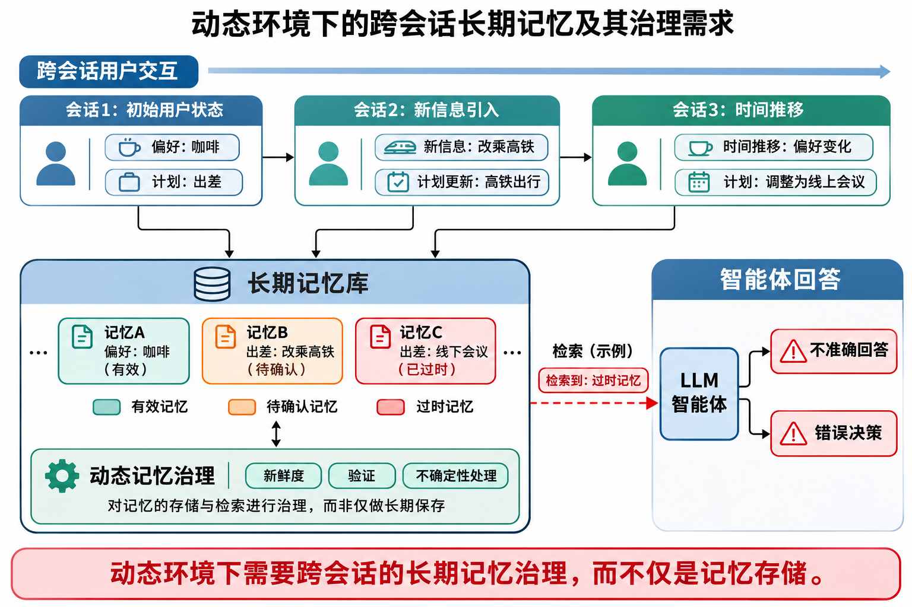

# 生图提示词与成图示例

写新图提示词时，参考下面从主题到分区、节点关系和视觉规范的写法。图的内容、布局和术语由当前报告的对应章节决定。

## 提示词原文

绘制一张符合 ACL、EMNLP、ICLR 等高水平学术会议论文风格的科研示意图，主题为“动态环境下的跨会话长期记忆及其治理需求”。

【图片布局】

采用从左到右的信息流布局，将整体划分为三个区域：

1. 跨会话用户交互区域：沿时间轴展示三个不同时间的用户会话，分别标记为“会话1：初始用户状态”“会话2：新信息引入”“会话3：时间推移”。使用简洁的对话框展示用户事实、偏好及计划随时间发生变化的过程。
2. 长期记忆库区域：展示一个持续保存历史交互信息的长期记忆库，内部包含多个结构化记忆节点，并通过不同颜色区分“有效记忆”“过时记忆”和“待确认记忆”。体现新信息与时间变化可能导致部分记忆失效。
3. 智能体回答区域：展示长期记忆通过检索进入大语言模型，辅助生成回答与任务决策的过程。使用红色虚线突出过时记忆被错误检索后可能产生的不准确回答，并引出“动态记忆治理”的必要性。

【视觉规范】

采用纯白色背景、扁平化矢量科研绘图风格、细线箭头、统一的圆角矩形节点及清晰的信息层次。采用低饱和度蓝色表示普通记忆，青绿色表示有效记忆，橙色表示待确认记忆，红色表示过时记忆及潜在错误。图片内部主要使用简洁、准确的中文标签，必要的专业缩写保留英文。

整体风格参考 EMNLP、ACL、ICLR 论文中的研究动机图，突出学术性、逻辑性和可读性。禁止使用三维立体效果、渐变背景、投影、卡通机器人及无关装饰。不得添加虚构的实验数据。

横向构图，宽高比为3:2，适合嵌入16:9的学术答辩PPT。

## 对应成图

